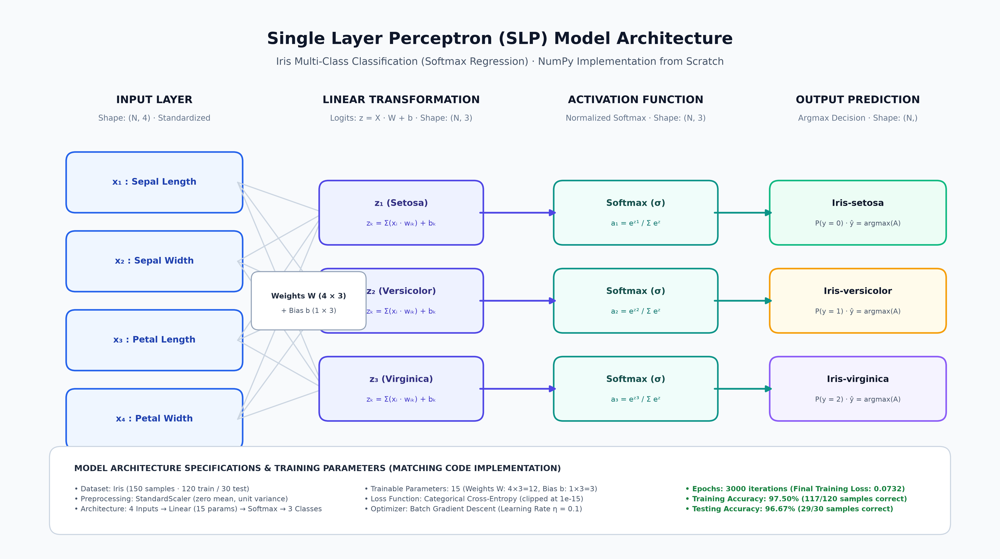
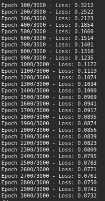
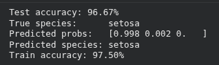

# Iris Flower Classification using Single Layer Perceptron (SLP)

A clean implementation of a **Single Layer Perceptron (SLP) / Softmax Regression** model built from scratch in Python using **NumPy** to classify the Fisher Iris dataset into three botanical species (*Iris setosa*, *Iris versicolor*, and *Iris virginica*).

---

## 📌 Project Overview & Introduction

The Single Layer Perceptron (SLP) is a foundational neural network architecture consisting of an input layer directly connected to an output layer without intermediate hidden layers. In multi-class classification problems, the SLP functions as **Multinomial Logistic Regression (Softmax Regression)**.

The objective of this project is to model the linear mapping from 4 botanical measurement features to 3 probability scores representing each Iris species using:
- Pure analytical gradient derivation (Backpropagation).
- Numerically stable Softmax activation.
- Categorical Cross-Entropy loss.
- Batch Gradient Descent optimization.

### Dataset Summary
- **Source**: Fisher's Iris Dataset (`sklearn.datasets.load_iris`)
- **Total Samples**: 150 (50 per class)
- **Features ($D = 4$)**:
  1. Sepal Length ($\text{cm}$)
  2. Sepal Width ($\text{cm}$)
  3. Petal Length ($\text{cm}$)
  4. Petal Width ($\text{cm}$)
- **Classes ($K = 3$)**:
  - Class `0`: *Iris setosa*
  - Class `1`: *Iris versicolor*
  - Class `2`: *Iris virginica*
- **Data Preprocessing**:
  - Stratified 80/20 train/test split (120 training samples, 30 testing samples).
  - Feature Standardization using `StandardScaler` ($\mu = 0, \sigma = 1$).
  - One-Hot Target Encoding ($Y \in \{0, 1\}^{N \times 3}$).

---

## 🏗️ Model Architecture

The architecture maps standardized inputs directly to class probabilities through a single weight matrix and bias vector.



### Layer Specifications

| Layer Component | Dimensions / Shape | Operation | Parameters Count |
| :--- | :--- | :--- | :--- |
| **Input Layer** | $(N, 4)$ | Standardized features $[x_1, x_2, x_3, x_4]$ | $0$ |
| **Weights ($W$)** | $(4, 3)$ | Initialized via $\mathcal{N}(0, 0.01^2)$ | $4 \times 3 = 12$ |
| **Bias ($b$)** | $(1, 3)$ | Initialized to zero vector $[0, 0, 0]$ | $1 \times 3 = 3$ |
| **Linear Logits ($z$)** | $(N, 3)$ | $z = X \cdot W + b$ | $0$ |
| **Activation Layer** | $(N, 3)$ | Softmax: $A_k = \frac{e^{z_k - \max(z)}}{\sum_{j=1}^3 e^{z_j - \max(z)}}$ | $0$ |
| **Output / Decision** | $(N,)$ | $\hat{y} = \arg\max_k(A_k)$ | $0$ |
| **Total Trainable** | — | — | **15 parameters** |

---

## 📐 Mathematical Formulation

### 1. Forward Propagation
Given an input batch matrix $X \in \mathbb{R}^{N \times 4}$:
$$z = X W + b$$

The continuous linear logits are normalized into posterior probabilities $A \in [0, 1]^{N \times 3}$ using the numerically stable Softmax function:
$$A_{i, k} = \frac{\exp(z_{i, k} - \max_j z_{i, j})}{\sum_{j=1}^{3} \exp(z_{i, j} - \max_j z_{i, j})}$$

### 2. Loss Function
The model optimizes the Categorical Cross-Entropy loss across all $N$ samples, clipped with $\epsilon = 10^{-15}$ to ensure numerical stability:
$$\mathcal{L}(W, b) = -\frac{1}{N} \sum_{i=1}^{N} \sum_{k=1}^{3} y_{i, k} \log(A_{i, k})$$

### 3. Gradient Calculation & Parameter Update
By chain rule, the gradient of the loss with respect to the pre-activation logits $z$ simplifies to:
$$dz = \frac{A - Y}{N} \quad \in \mathbb{R}^{N \times 3}$$

Gradients with respect to weights $W$ and bias $b$:
$$dW = X^T \cdot dz \quad \in \mathbb{R}^{4 \times 3}$$
$$db = \sum_{i=1}^{N} dz_i \quad \in \mathbb{R}^{1 \times 3}$$

Parameters are updated using Batch Gradient Descent with learning rate $\eta = 0.1$:
$$W \leftarrow W - \eta \, dW$$
$$b \leftarrow b - \eta \, db$$

---

## 📊 Experimental Results & Outputs

### 1. Training Convergence (Loss Progression)
The model was trained for **3,000 epochs**. The loss steadily decreased from $0.3212$ at epoch 100 down to $0.0732$ at epoch 3000:



### 2. Model Evaluation
The final parameters were evaluated on both the training partition and unseen test partition:



### Performance Summary Table

| Metric | Result | Details |
| :--- | :--- | :--- |
| **Training Accuracy** | **97.50%** | $117 / 120$ training samples classified correctly |
| **Test Accuracy** | **96.67%** | $29 / 30$ test samples classified correctly |
| **Final Training Loss** | **0.0732** | Categorical Cross-Entropy |
| **Learning Rate ($\eta$)** | **0.1** | Constant step size |
| **Total Iterations** | **3,000** | Full-batch convergence |

### Sample Test Prediction
For the first test flower sample (*Iris setosa*):
- **True Label**: `setosa`
- **Model Output Probabilities**: `[0.998, 0.002, 0.000]`
- **Predicted Class**: `setosa` (Confident correct prediction)

---

## 🔍 Limitations of SLP & Strategies to Increase Accuracy

While the Single Layer Perceptron achieves strong performance ($96.67\%$ test accuracy), it has fundamental architectural and algorithmic constraints. Below are key limitations and technical strategies to address them:

### 1. Inability to Model Non-Linear Decision Boundaries
- **Limitation**: An SLP generates strictly linear hyperplanes ($XW + b = 0$). While *Iris setosa* is linearly separable from the other two classes, *Iris versicolor* and *Iris virginica* exhibit overlapping distributions in feature space and are **not strictly linearly separable**. A single linear layer cannot form curved or enclosed decision surfaces.
- **Solution to Increase Accuracy**:
  - Upgrade to a **Multi-Layer Perceptron (MLP)** by introducing at least one hidden layer with non-linear activation functions (e.g., ReLU, LeakyReLU, or GELU). Hidden units transform feature space non-linearly to separate overlapping clusters, pushing test accuracy towards $100\%$.
  - Alternatively, engineer polynomial features ($x_i^2, x_i x_j$) or use a Kernelized classifier (e.g., Support Vector Classifier with RBF kernel).

### 2. Full-Batch Gradient Descent vs. Mini-Batch Stochastic Updates
- **Limitation**: Computing gradients over the full dataset ($N=120$) at every step produces deterministic gradient steps that can get trapped in flat regions or slow down near saddle points.
- **Solution to Increase Accuracy**:
  - Implement **Mini-Batch SGD** (e.g., batch sizes of 16 or 32) with random shuffling per epoch. The stochastic gradient noise helps escape shallow local minima and provides implicit regularization, improving generalization on unseen test data.

### 3. Fixed Learning Rate without Momentum or Adaptive Moments
- **Limitation**: The model employs a static learning rate ($\eta = 0.1$). Near convergence, gradient magnitudes become small ($dW \approx 10^{-3}$), leading to slow asymptotic convergence or oscillations across narrow loss ravines.
- **Solution to Increase Accuracy**:
  - Implement adaptive optimizers such as **Adam** or **RMSprop**, or add **Momentum** to the update step ($v = \beta v + (1-\beta)dW$).
  - Utilize a learning rate scheduler (e.g., StepLR or Cosine Annealing) to decay $\eta$ in later epochs, allowing precise convergence to the global minimum.

### 4. Absence of Regularization (Weight Penalty)
- **Limitation**: Standard Cross-Entropy without regularization can drive weights to large values when striving to output probabilities approaching $1.0$, which can lead to overconfidence and degraded margins.
- **Solution to Increase Accuracy**:
  - Add **$L_2$ Regularization (Weight Decay / Ridge Penalty)** to the objective:
    $$\mathcal{L}_{\text{reg}} = \mathcal{L} + \frac{\lambda}{2N} \|W\|_F^2$$
  - This constrains weight norms, smooths the decision boundaries, and reduces variance on small datasets.

### 5. High Variance from Small Sample Size & Single Split
- **Limitation**: With only 30 test samples, misclassifying a single flower alters the measured test accuracy by $3.33\%$. A single train/test split may introduce sampling variance.
- **Solution to Increase Accuracy & Reliability**:
  - Implement **$k$-Fold Stratified Cross-Validation** ($k=5$ or $k=10$). Reporting the mean accuracy and standard deviation across all folds provides a statistically robust measure of model generalization.

---

## 📁 Repository Structure

```text
iris-classification-slp/
├── assets/
│   ├── model_architecture.png     # Publication-grade model architecture diagram
│   ├── slp1.png                   # Execution screenshot: Evaluation & test accuracy
│   └── slp2.png                   # Execution screenshot: Training loss progression
├── SLP.ipynb                      # Interactive Jupyter Notebook implementation
├── slp.py                         # Standalone Python script implementation
├── requirements.txt               # Environment dependencies
├── .gitignore                     # Git ignore rules
└── README.md                      # Project documentation and analysis
```

---

## 🚀 How to Run

### 1. Clone the Repository
```bash
git clone https://github.com/vedpatel987612-glitch/iris-classification-slp.git
cd iris-classification-slp
```

### 2. Set Up Virtual Environment & Install Dependencies
```bash
python3 -m venv venv
source venv/bin/activate
pip install -r requirements.txt
```

### 3. Execute the Code

**Option A: Run Standalone Python Script**
```bash
python slp.py
```

**Option B: Launch Jupyter Notebook**
```bash
jupyter notebook SLP.ipynb
```

---

## 👤 Author

**Ved Patel**  
- GitHub: [@vedpatel987612-glitch](https://github.com/vedpatel987612-glitch)  
- Focus: Machine Learning, Deep Learning, Computer Vision
